# Automação cartorária autônoma

[](https://github.com/levymoraes/automacao-cartoraria/actions/workflows/ci.yml)

Automação de minutas com **n8n, Node.js, Linear e leitura estruturada por IA**. Projeto implementado e validado de ponta a ponta: consulta a fila, identifica o modelo solicitado, processa os documentos, preenche o DOCX, registra pendências e entrega o arquivo para revisão humana.

Desenvolvido por [Levy Moraes](https://github.com/levymoraes).

## O que a automação faz

- **Trabalha por agendamento:** consulta tarefas elegíveis em horários configuráveis e recupera a fila ao iniciar. Exemplo incluído: 11h e 16h, no fuso `America/Sao_Paulo`.
- **Processa a fila com autonomia:** seleciona a tarefa e o modelo correspondente, carrega os PDFs, solicita uma leitura estruturada e executa o preenchimento local.
- **Preserva o modelo:** usa uma cópia preparada com campos e confere texto fixo, estrutura, imagens e formatação dos caracteres.
- **Trata documentos incompletos:** aproveita os dados sustentados pelas fontes e destaca informações ausentes ou conflitantes em vermelho.
- **Distribui avisos pelo documento:** declarações sem comprovação recebem avisos próximos às cláusulas pertinentes.
- **Entrega automaticamente no Linear:** confirma o arquivo por download e hash, registra as pendências e muda a tarefa para **In Review**.
- **Retoma sem duplicar entregas:** mantém estado e recibos entre execuções; uma falha de transporte da IA não provoca uma segunda cobrança automática.
- **Controla concorrência e consumo:** usa bloqueio de execução, autorização explícita e reserva persistente de orçamento.

A autonomia cobre o processamento técnico. **Cada minuta exige conferência e aprovação humana antes do uso.** O estado In Review indica uma entrega para revisão, sem aprovação documental ou jurídica automática.

## Arquitetura

```mermaid
flowchart LR
    A[Horário configurado ou inicialização] --> B[n8n consulta a fila no Linear]
    B --> C[Verificar tarefa, modelo e PDFs]
    C --> D[Uma leitura estruturada pela IA]
    D --> E[Validar fontes, entidades e pendências]
    E --> F[Preencher DOCX localmente]
    F --> G[Conferir integridade e formatação]
    G --> H[Anexar e confirmar por hash]
    H --> I[Registrar pendências e mover para In Review]
    I --> J[Conferência e aprovação humana]
```



O caminho atual, `template-fields`, faz **uma chamada de leitura por tarefa**, seguida de preenchimento com Docxtemplater. Não precisa de uma chamada de IA para editar o Word. A resposta contém valores, estados e referências às fontes; o código local controla as alterações permitidas.

## Execute a demonstração

Requer Node.js 22 ou superior. Não exige conta no Linear, chave de API, Docker ou Word.

```bash
npm ci --ignore-scripts
npm test
npm run demo
```

A demonstração gera um modelo e um PDF inteiramente fictícios, simula a resposta da IA e o Linear em `127.0.0.1`, e exercita o caminho operacional de preenchimento, auditoria, entrega e retomada. Produz um DOCX com um CPF ausente marcado em vermelho e confirma que executar novamente não duplica o anexo. Os arquivos ficam em `storage/demo/`, fora do Git.

**A demonstração simula a interpretação por IA.** Ela verifica o código e o fluxo de entrega, sem realizar extração visual real ou chamadas pagas.

## Agendamentos e execução autônoma

```bash
npm run workflows:build
```

O comando gera os workflows n8n manual e agendado em `workflows/exported/`. O workflow agendado contém gatilhos de horário e inicialização; a mesma função `runBatch` executa o lote, consulta a elegibilidade e preserva o estado.

Os exports são distribuídos **desativados**, com chamadas pagas bloqueadas por padrão. A ativação é uma etapa de instalação: exige infraestrutura n8n, dependências locais, modelos preparados, credenciais próprias, vínculo com a fila e autorização de consumo. O repositório público não contém a configuração de uma instituição e não é um instalador da operação privada.

## Decisões de engenharia

| Problema | Solução implementada |
|---|---|
| Associar um dado à pessoa errada | Vínculos entre participante, papel, campo, documento, página e finalidade da evidência |
| Herdar valores de uma minuta anterior | Dados antigos não servem como prova; campos precisam de novas evidências |
| Documento ausente ou modelo incompatível | Minuta preliminar coerente com pendências explícitas, sem inventar partes ou reescrever cláusulas |
| Quebrar o Word durante o preenchimento | Validação do pacote DOCX e comparação de texto fixo, partes e estilos |
| Duplicar arquivo ao retomar uma execução | Estado persistente, checkpoints e confirmação da entrega por hash |
| Repetir uma cobrança após timeout | Persistência da tentativa e ausência de retry automático da chamada paga |
| Expor credenciais por erro ou redirecionamento | Códigos de erro controlados, verificação de destino e testes de transporte |

## Validação e testes

O projeto completo foi validado em seis modelos de minuta e em uma entrega integrada real. Os documentos e os registros dessa operação permanecem privados. A implantação em cada instituição exige a configuração e a conferência inicial do próprio ambiente.

Esta edição pública contém regressões executáveis com dados fictícios: qualificação com documentos alternativos, lacunas, contradições, vínculos conjugais, declarações sem comprovação, integridade de DOCX, falhas de upload, recuperação de estado, isolamento de tarefas e orçamento. Resultados simulados não representam uma garantia de precisão da IA em documentos inéditos.

O GitHub Actions executa a verificação de publicação, os testes, a demonstração e a geração dos workflows. Nenhum segredo é necessário para essa rotina.

## Código

| Caminho | Responsabilidade |
|---|---|
| `src/automation.cjs` | Orquestração, elegibilidade, estado e entrega |
| `src/template-fill.cjs` | Leitura estruturada, preenchimento e conferência do DOCX |
| `src/documentary-audit.cjs` | Evidências, participantes e pendências documentais |
| `src/template-presentation.cjs` | Ajustes locais delimitados de apresentação e avisos |
| `src/linear.cjs` | Cliente Linear e confirmação da entrega |
| `src/budget.cjs` e `src/job-store.cjs` | Reserva de orçamento, recibos e persistência |
| `scripts/build-automation.cjs` | Geração dos workflows n8n |
| `tests/` | Regressões, fixtures e simulador local |

Os módulos anteriores de leitura e edição permanecem como histórico técnico e compatibilidade. O caminho atual está descrito acima; eles não acrescentam chamadas ao fluxo `template-fields`.

## Privacidade e escopo público

Esta edição foi exportada por uma lista permitida de arquivos e recebeu histórico Git novo. Não inclui modelos institucionais, PDFs recebidos, minutas reais, relatórios internos, respostas reais da API, credenciais ou identificadores do workspace utilizado no desenvolvimento.

```bash
npm run check
```

A verificação identifica arquivos proibidos e padrões de conteúdo sensível. É um controle preventivo, acompanhado de revisão do conjunto publicado. Veja [a política de publicação](docs/PUBLICACAO.md) e [o estudo de caso](docs/ESTUDO-DE-CASO.md).

O código está publicado para apresentação e avaliação técnica. Não foi atribuída uma licença de software a esta edição; as dependências mantêm suas próprias licenças.
